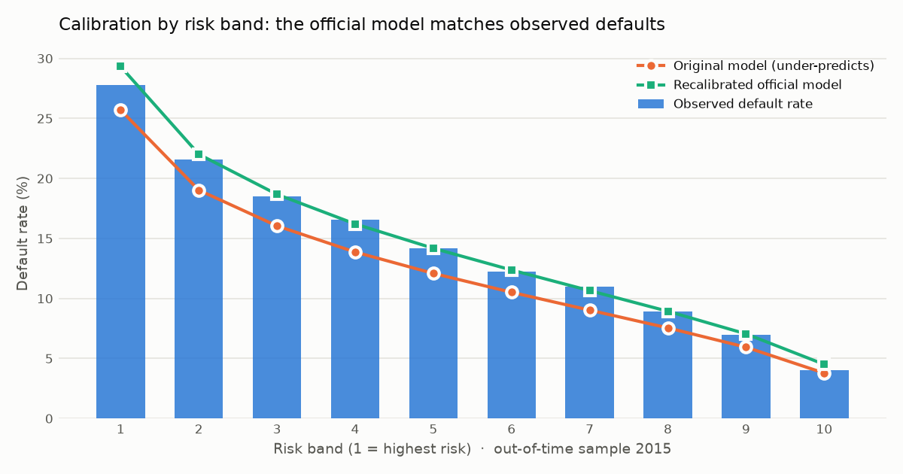
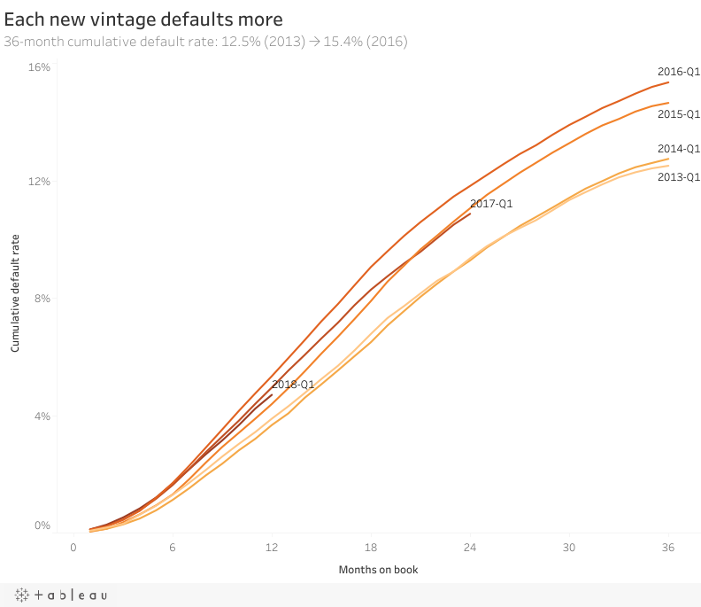
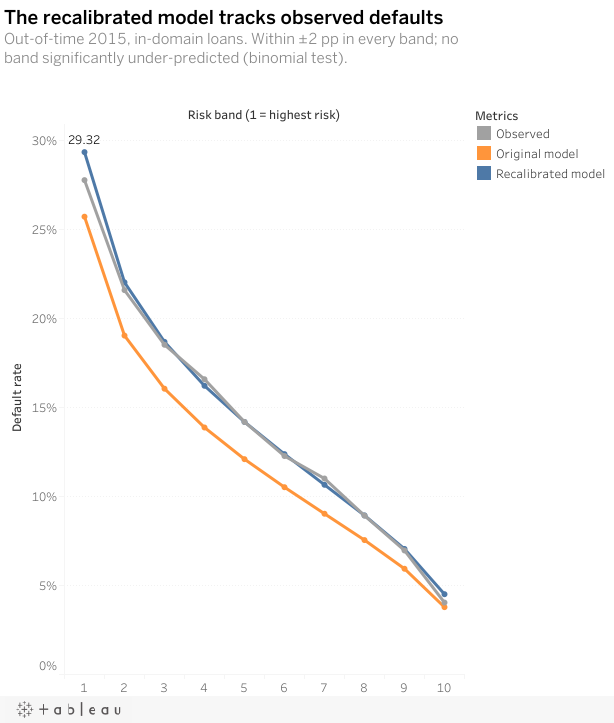
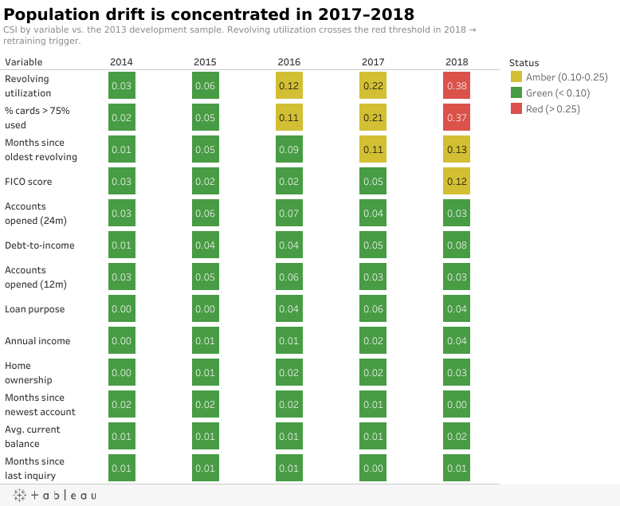
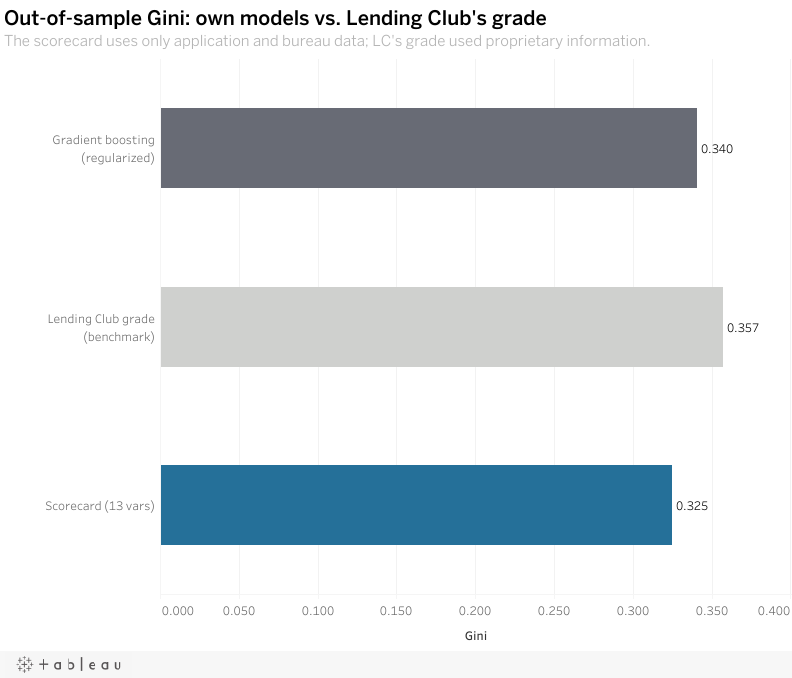

# Credit Risk: PD Model, Independent Validation & IFRS 9 ECL

[](https://github.com/sannti09/credit-risk-pd-validation/actions/workflows/ci.yml)

End-to-end credit risk project on **2.26 million Lending Club consumer loans (2007–2018)**: a probability-of-default
(PD) scorecard built in SQL and Python, validated the way a bank's model validation team would, and used to compute
**IFRS 9 expected credit losses** on a live portfolio of US$ 4.6 billion.

## Summary for recruiters

- **Built** a PD scorecard (logistic regression on Weight of Evidence) and a gradient-boosting challenger, using only
  information available when the loan is approved.
- **Validated** it independently: discrimination, calibration, stability, representativeness and overfitting checks,
  summarized in a traffic-light report with findings and conditions.
- **Fixed what validation found:** the model ranked risk well but under-predicted defaults by 2 points; it was
  recalibrated and restricted to the population it was trained on.
- **Computed IFRS 9 ECL:** stage allocation, 12-month and lifetime PD, observed LGD, amortizing exposure, weighted
  macro scenarios and sensitivity analysis.
- **Caught and documented** data leakage, data-collection artifacts and selection bias, with every decision logged.

<picture>
  <source media="(prefers-color-scheme: dark)" srcset="docs/img/calibration_oot_dark.png">
  
</picture>

## Interactive dashboard (Tableau Public)

Click an image to open the interactive version (filters and tooltips) on Tableau Public.

<table>
  <tr>
    <td width="50%"><a href="https://public.tableau.com/app/profile/santiago.rueda4047/viz/CreditRiskPDIFRS9LendingClub/Vintage"></a></td>
    <td width="50%"><a href="https://public.tableau.com/app/profile/santiago.rueda4047/viz/CreditRiskPDIFRS9LendingClub/Calibration"></a></td>
  </tr>
  <tr>
    <td width="50%"><a href="https://public.tableau.com/app/profile/santiago.rueda4047/viz/CreditRiskPDIFRS9LendingClub/Stability"></a></td>
    <td width="50%"><a href="https://public.tableau.com/app/profile/santiago.rueda4047/viz/CreditRiskPDIFRS9LendingClub/Performance_"></a></td>
  </tr>
</table>

## Key results

| Area | Result |
|---|---|
| Discrimination (out-of-time 2015) | Gini **0.325** · KS 0.237 · no degradation vs. training (−0.3%) |
| Benchmark | Lending Club's own grade: Gini 0.357 · regularized GBM challenger: 0.340 |
| Calibration (out-of-time 2015) | Original model 12.9% vs. 14.9% observed (9 of 10 bands significantly under-predicted) → official model, in its domain: **14.9% vs. 14.6%**, 0 bands significantly under-predicted (binomial test) |
| Stability | Score PSI < 0.10 through 2018; `revol_util` CSI red in 2018 → retraining trigger |
| Validation verdict | 6 🟢 · 5 🟡 · 2 🔴 — **approved with conditions**, conditions implemented in code |
| IFRS 9 portfolio (Mar 2019) | 582,796 loans · US$ 4,638 M · stages 88.8% / 10.2% / 1.0% of balance |
| Observed LGD | **90.7%** (discounted recoveries of charged-off loans) |
| Expected credit loss | **US$ 238.1 M (5.1% coverage)**, probability-weighted across 3 scenarios |
| Colombian regulator benchmark (SFC MRCO) | Matrix A: US$ 221.1 M (4.8%) · Matrix B (adds the countercyclical component): US$ 335.0 M (7.2%) |

## Things a validator would ask about

- **Right censoring / immature vintages.** 2016–2018 loans have not finished; their observed default rate is inflated
  because early defaults show up first. Modeling uses only mature 36-month cohorts (2013–2015).
- **Data leakage.** Post-origination fields (payments, recoveries, last FICO) are excluded from the PD model. The GBM
  rediscovered Lending Club's interest rate through `installment` (fixed term ⇒ installment + amount reveal the rate);
  it was removed.
- **Data-collection artifact.** A CSI of 0.84 turned out to be missing bureau fields in 2012, not a population shift.
- **Train / validation / out-of-time split** (2013 / 2014 / 2015) so the final test does not drive modeling decisions;
  remaining process limitations are disclosed.
- **Selection bias.** The model only sees approved loans. Approved vs. rejected applicants were compared (PSI) and
  the model is restricted to its **domain** (FICO ≥ 660, DTI ≤ 34.99, the range seen in development): Lending Club raised its DTI cap in 2014 and those
  loans default at 22.6%.
- **IFRS 9 staging.** Lending Club reports "Late (31–120 days)" as one bucket; days past due were estimated from the
  last payment date to apply the 90-day default presumption correctly.

## Method

| Phase | What | Where |
|---|---|---|
| 1. Data & SQL | Raw load, quality checks, typing, default definition, model sample (DuckDB) | `sql/01–04` |
| 2. PD model | Monotonic coarse classing, WoE/IV, feature selection, logistic scorecard (PDO 20), GBM challenger with monotonic constraints | `notebooks/02, 03, 07`, `src/credit_risk/woe.py` |
| 3. Validation | Gini/KS, PSI/CSI, Hosmer-Lemeshow, binomial test by band, approved vs. rejected, recalibration + margin of conservatism, monitoring | `notebooks/04–06, 08, 09`, `src/credit_risk/validation.py` |
| 4. IFRS 9 | Staging (DPD + FICO-drop SICR), PD term structure, LGD, monthly ECL with amortizing EAD and EIR discounting, scenarios | `sql/07`, `notebooks/10–12`, `src/credit_risk/ifrs9.py` |
| 5. SFC benchmark | Provision under Colombia's consumer reference model (MRCO, matrices A/B) vs. IFRS 9 ECL | `notebooks/15`, `docs/decisiones.md` (D25, sources) |

- **Validation report:** [`reports/validation_report.md`](reports/validation_report.md) — generated from the results
  (Spanish version: [`informe_validacion.md`](reports/informe_validacion.md))
- **Decision log:** [`docs/decisiones.md`](docs/decisiones.md) — every modeling decision with its rationale (in Spanish;
  key decisions summarized below)

## Key modeling decisions

| Decision | Choice | Why |
|---|---|---|
| Default definition | Charged off, default or 31–120 days late = 1; fully paid = 0 | Standard lifetime-default target; unresolved loans excluded |
| Sample | 36-month loans, 2013–2015 vintages | Mature outcomes only (right censoring); 2012 lacked bureau fields |
| Split | Train 2013 · validation 2014 · out-of-time 2015 | The final test never drives modeling choices |
| Predictors | Application and bureau data only | No post-origination fields (leakage); Lending Club's grade, rate and installment excluded |
| Binning | Monotonic coarse classing, ≥ 5% per bin | Explainable, stable Weight of Evidence |
| Calibration | Intercept recalibration + margin of conservatism | Defaults rose ~1.4 pts/year; ranking was fine, level was not |
| Domain | FICO ≥ 660, DTI ≤ 34.99 | Ranges seen in development; no PD outside them |
| IFRS 9 staging | Stage 3 at 90+ days past due; stage 2 at 31–89 days or a FICO drop ≥ 50 | 90-day default presumption; days past due estimated from the last payment date |
| LGD | Observed 90.7%, discounted | Measured on charged-off recoveries instead of Basel's 45% |
| Challenger | Gradient boosting with shallow trees and monotonic constraints | Overfitting gap cut from 0.14 to 0.03 Gini points |

**Languages:** code, README, dashboard, API and validation report are in English. The detailed decision log is in
Spanish (the project was developed in Colombia); its key points are in the table above.

## Scoring API

The official model is exported to a versioned JSON spec (`models/scorecard_v1.json`) and served with FastAPI.
No pickle in production: the lightweight scorer reproduces the model's PD exactly (max difference 2e-16).

```bash
docker build -t credit-pd-api .
docker run -p 8000:8000 credit-pd-api        # docs at http://localhost:8000/docs
curl -X POST localhost:8000/score -H "Content-Type: application/json" \
  -d '{"fico_low": 690, "dti": 18.5, "annual_inc": 65000, "revol_util": 55, "home_ownership": "RENT"}'
```

Response: PD, score, whether the applicant is inside the model's domain, and the top-3 **reason codes**
(variables that cost the most points). Out-of-domain applicants (FICO < 660 or DTI > 34.99) get no PD.

## Cloud (AWS)

The cleaned loan table is stored in S3 as **Parquet partitioned by year** (86 MB vs. 1.6 GB of raw CSV) and queried
with **Athena**. The vintage-curve SQL runs in the cloud and returns results identical to the local DuckDB version,
scanning only 2.3 MB thanks to partition pruning and columnar storage. Scripts in `aws/` (upload, Athena DDL generated
from the Parquet schema, cleanup).

The same scorer is also deployed as an **AWS Lambda** function (8 KB package, no dependencies, least-privilege role),
returning the same PD and reason codes as the Docker API.

### Try the live API

Public endpoint behind **API Gateway** with a shared key and a usage plan (100,000 calls/month, 5 per second): the
key below is public on purpose; the monthly quota caps usage for everyone.

```bash
curl -X POST https://jzhpsfgioa.execute-api.us-east-2.amazonaws.com/v1/score \
  -H "x-api-key: S01nstfY6u5S0FZrrE80d3J0gr0yK9XE37xLS7Qs" -H "Content-Type: application/json" \
  -d '{"fico_low": 690, "dti": 18.5, "annual_inc": 65000, "revol_util": 55, "home_ownership": "RENT"}'
```

## Reproduce

1. Download the [Lending Club dataset from Kaggle](https://www.kaggle.com/datasets/wordsforthewise/lending-club)
   and unzip it into `data/raw/lending_club_kaggle/` (data is not versioned).
2. Run:
   ```bash
   uv sync
   uv run python run_pipeline.py   # full pipeline, ~3 minutes
   uv run pytest                   # unit, API, Lambda and parity tests
   ```

## Limitations

- US peer-to-peer data from 2013–2018: demonstrative, not a production model.
- No monthly payment history: no stage-transition matrices; days past due are approximated.
- IFRS 9 scenarios are expert-judgment overlays, not a macroeconomic satellite model.
- Selection bias cannot be corrected (rejected applicants have no performance); it is quantified and bounded instead.

## Stack

Python (pandas, scikit-learn, statsmodels, matplotlib) · DuckDB (SQL) · FastAPI · Docker · GitHub Actions · AWS (S3, Athena, Lambda, API Gateway) · pytest · uv

---

## Resumen en español

Proyecto de riesgo de crédito de punta a punta sobre 2,26 millones de préstamos de consumo de Lending Club:
modelo de PD (scorecard logístico con WoE y challenger de gradient boosting), **validación independiente** con
semáforos (discriminación, calibración, estabilidad, representatividad y sobreajuste) y **pérdida esperada NIIF 9**
sobre una cartera viva de US$ 4.638 M (etapas, PD 12 meses y de vida, LGD observada de 90,7%, escenarios
ponderados). Resultado: ECL de US$ 238,1 M (5,1% del saldo), comparada con la provisión del modelo de referencia
de consumo de la SFC (MRCO): US$ 221,1 M con la Matriz A y US$ 335,0 M con la Matriz B. El informe de validación y el registro de todas las
decisiones de modelado están en español en `reports/` y `docs/`.
